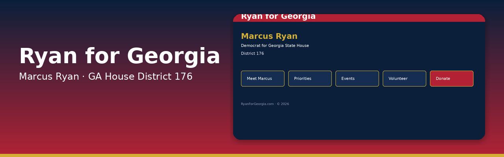
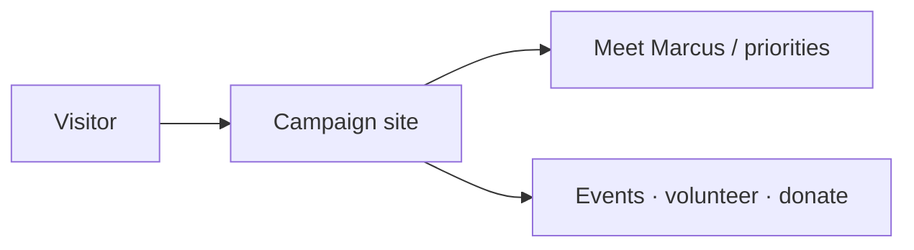

<p align="center">
  
</p>

# Ryan for Georgia

**Campaign website for Marcus Ryan, Democrat for Georgia State House, District 176.**

[](#license)


Vite/React site with about, issues, events, volunteer, and donate sections. Footer states © 2026 RyanForGeorgia.com. Stock AI Studio README was replaced.


## How it works



Vite/React campaign site for Marcus Ryan (GA House District 176). Georgia-themed navy / red / gold styling.

## Features

- Campaign sections: Meet Marcus, priorities, events, volunteer, donate CTA
- Georgia-themed styling (navy / red / gold)
- Optional Gemini service module

## Tech stack

- Vite + React + TypeScript
- Tailwind CSS
- Optional @google/genai

## How to run

```bash
npm install
npm run dev
```

Optional: set `GEMINI_API_KEY` in `.env.local` (see `.env.example`).

## Environment variables

Names only. Never commit values.

- `GEMINI_API_KEY`
- `APP_URL`

## Status

Public. Campaign site scaffold for District 176 (2026).

## License

All rights reserved. Site copy references Paid for by Marcus Ryan for Georgia.
